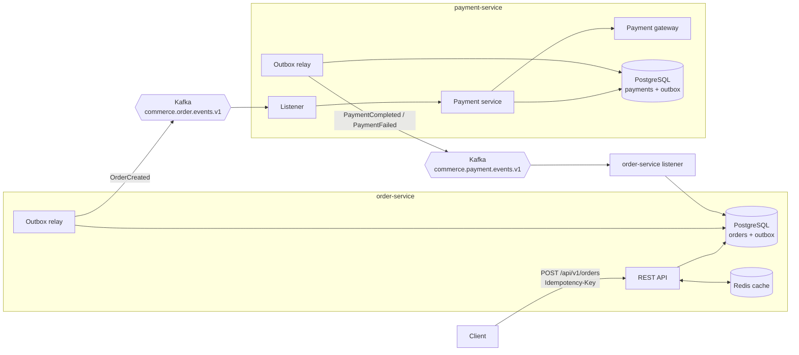
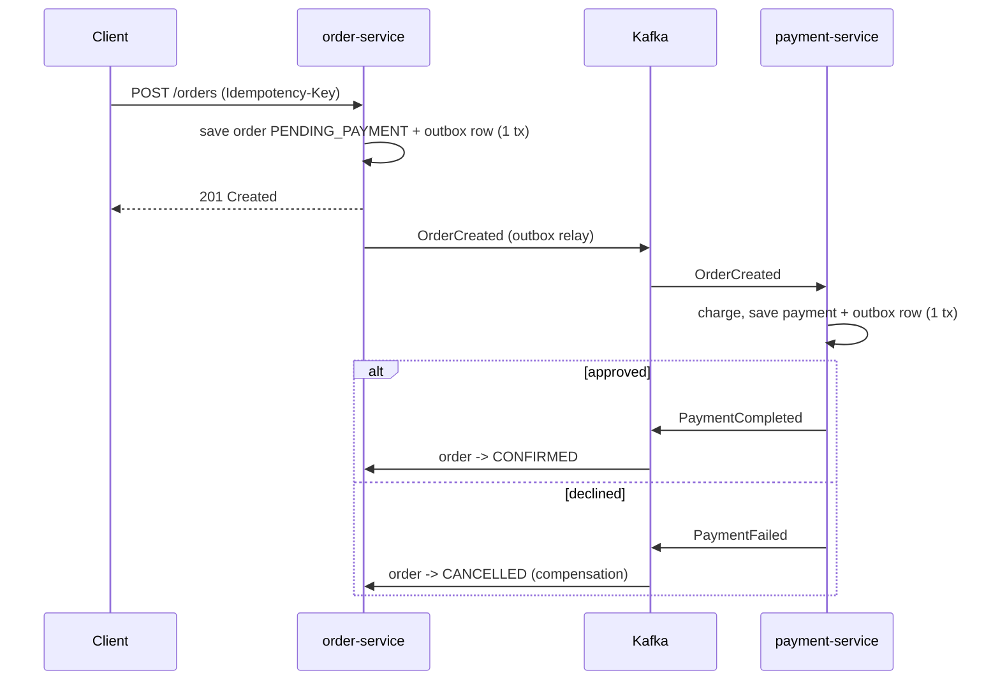

# commerce-order-platform

[](https://github.com/sameerkhanp119-dot/commerce-order-platform/actions/workflows/ci.yml)


Event-driven order and payment microservices that stay consistent **without distributed transactions**.
An order is accepted, a payment is attempted, and the order is either confirmed or compensated (cancelled) —
all coordinated through Kafka using a **choreography saga** and the **transactional outbox** pattern.

## Architecture



### Saga flow



## Design decisions

| Problem | Approach |
|---|---|
| **Dual write** (DB commit succeeds, Kafka publish fails, or vice versa) | Transactional outbox: the event row is written in the same transaction as the business change; a relay publishes it afterwards. |
| **Duplicate client requests** (retries, double clicks) | Mandatory `Idempotency-Key` header backed by a unique DB constraint. A replay returns `200` with the original order; a concurrent race returns `409`. |
| **At-least-once delivery** from Kafka | Every consumer is idempotent: payment uses a unique `order_id`; order state transitions are no-ops when already applied. |
| **Event ordering per order** | Events are keyed by order id, so all events for one order share a partition. The relay stops at the first failure rather than skipping ahead. |
| **Poison messages** | `DefaultErrorHandler` retries with exponential backoff, then routes the record to `<topic>.DLT` so the partition keeps moving. |
| **Read load on order lookups** | Redis read-through cache with eviction on every state change; Redis failures degrade to DB reads instead of errors. |
| **Schema drift** | Flyway migrations own the schema; Hibernate runs with `ddl-auto: validate`. |

## Tech stack

Java 21 · Spring Boot 3.3 · Spring Data JPA · Spring Kafka · PostgreSQL 16 · Flyway · Redis · Apache Kafka 3.8 (KRaft) ·
Micrometer/Prometheus · JUnit 5 · Mockito · AssertJ · Docker · Kubernetes · GitHub Actions

## Project layout

```
common-events/     event contracts (Java records) shared by both services
order-service/     REST API, order aggregate, outbox, payment-event listener, Redis cache
payment-service/   order-event listener, payment processing, gateway port + simulator, outbox
k8s/               Deployments, Services, HPAs, PodDisruptionBudgets
infra/             local Postgres bootstrap
.github/workflows  build, test, and publish images to GHCR
```

## Run it locally

Requirements: Docker, plus JDK 21 and Maven 3.9 if you want to run tests outside Docker.

```bash
docker compose up --build
```

| URL | What |
|---|---|
| http://localhost:8081/api/v1/orders | order-service |
| http://localhost:8082/actuator/health | payment-service |
| http://localhost:8090 | Kafka UI (watch the events flow) |

### Try the happy path

```bash
curl -s -X POST localhost:8081/api/v1/orders \
  -H 'Content-Type: application/json' -H 'Idempotency-Key: demo-001' \
  -d '{"customerId":"cust-42","currency":"USD","lines":[{"sku":"KB-01","quantity":2,"unitPrice":49.50}]}'

# a second later the status flips from PENDING_PAYMENT to CONFIRMED
curl -s localhost:8081/api/v1/orders/<id>
```

### Try the compensation path

The payment simulator declines anything above `1000.00` (configurable with `PAYMENT_DECLINE_ABOVE`):

```bash
curl -s -X POST localhost:8081/api/v1/orders \
  -H 'Content-Type: application/json' -H 'Idempotency-Key: demo-002' \
  -d '{"customerId":"cust-42","currency":"USD","lines":[{"sku":"TV-65","quantity":1,"unitPrice":1899.00}]}'
# -> ends as CANCELLED with failureReason "amount exceeds limit of 1000.00 USD"
```

### Try idempotency

Repeat the first request with the same `Idempotency-Key`: you get `200 OK` and the same order id, and no second payment is taken.

## Tests

```bash
mvn verify
```

Unit tests cover the order state machine, idempotent order placement, saga compensation, duplicate-event handling in payments, and the gateway simulator.

## Deploying to Kubernetes

CI publishes `ghcr.io/sameerkhanp119-dot/order-service` and `payment-service` on every push to `main`.

```bash
kubectl apply -f k8s/namespace.yaml
kubectl -n commerce create secret generic order-service-db --from-literal=username=orders --from-literal=password=...
kubectl -n commerce create secret generic payment-service-db --from-literal=username=payments --from-literal=password=...
kubectl apply -f k8s/
```

Deployments use zero-downtime rolling updates, readiness/liveness probes on Spring Boot health groups,
CPU-based autoscaling (2–6 pods), and a PodDisruptionBudget. Postgres, Kafka and Redis are expected to be
provided by managed services (RDS / MSK / ElastiCache or their GCP/Azure equivalents).

## Roadmap

- Testcontainers integration tests for the full saga
- Inventory reservation as a third saga participant
- OpenTelemetry tracing across the Kafka hop
- Debezium CDC as an alternative to the polling outbox relay

## License

MIT
